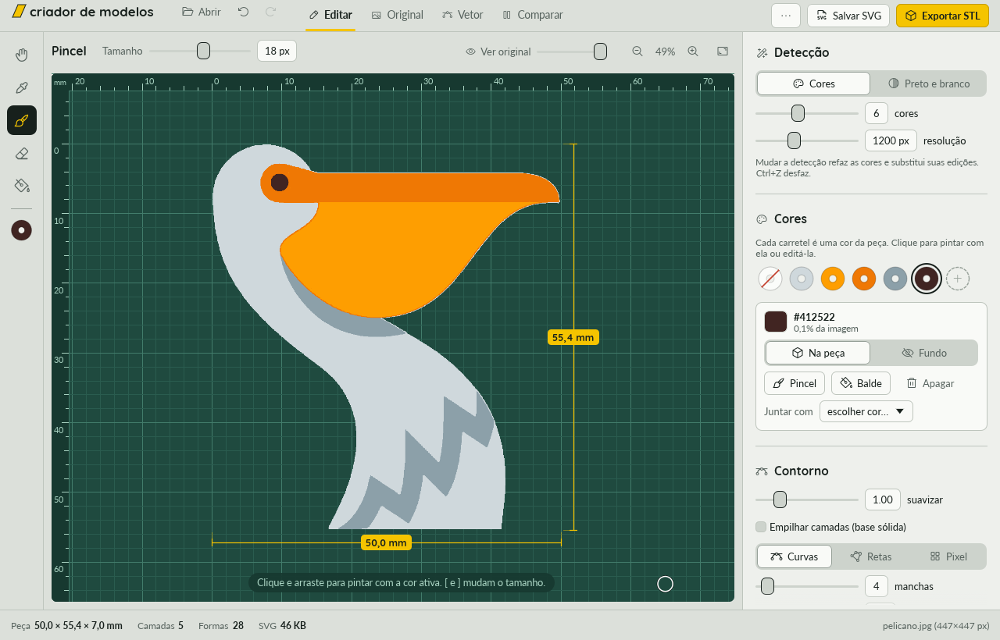
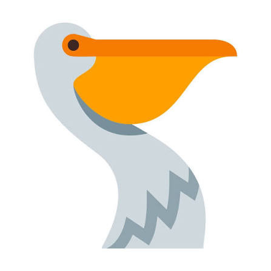
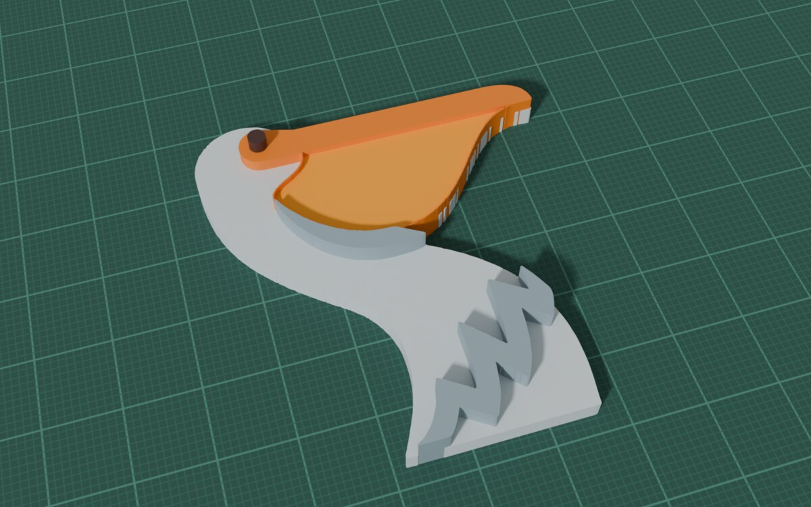
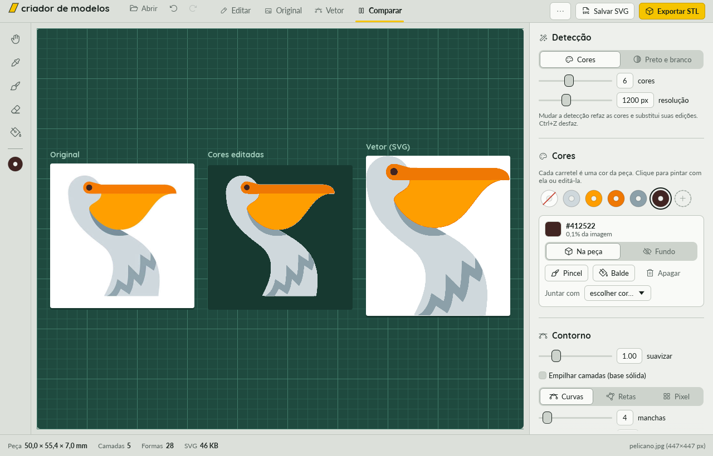

# Criador de Modelos

**Da imagem ao SVG e ao STL, num programa só.** App desktop gratuito, escrito em Rust, para quem transforma imagens em chaveiros, placas, carimbos e outras peças impressas em 3D.



## Por que existe

Converter uma imagem para impressão 3D costuma exigir várias ferramentas: uma para limpar ou separar as cores, um site para vetorizar, outro programa para extrudar e só então o slicer. Cada passo perde qualidade, e nenhum deles mostra o tamanho real da peça.

O Criador de Modelos junta esses passos:

```
antes:  imagem → editor de imagem → site de vetorização → programa 3D → slicer
agora:  imagem → Criador de Modelos (SVG ou STL) → slicer
```

## O que ele faz

- **Detecta as cores** principais da imagem (ou separa em preto e branco). Cada cor vira uma camada.
- **Edição à mão**: pincel, borracha, balde de tinta, conta-gotas, cores novas, juntar cores. Desfazer e refazer com `Ctrl+Z` / `Ctrl+Y`.
- **Tamanho real**: a área de edição é uma base de corte com grade e réguas em milímetros, ligadas à largura que você vai exportar, e cotas da peça.
- **Exporta SVG** com tamanho físico em mm (o slicer importa na escala certa), um SVG por cor, ou o PNG editado.
- **Exporta STL** já extrudado: base sólida e cada cor como um degrau de relevo. Opcionalmente, um STL por cor para impressão multicor.
- Gratuito e de código aberto ([MIT](LICENSE)).

## Exemplo: o pelicano

Uma homenagem ao teste do "pelicano em SVG". Em vez de pedir para alguém desenhar um pelicano em código, partimos de uma ilustração de 447 × 447 px:

1. **Detecção** com 6 cores: o fundo branco foi reconhecido sozinho e ficou transparente.
2. **Ajuste à mão**: o olho, pequeno demais para a detecção, foi devolvido com uma **cor nova** e o **pincel**; uma cor de transição na borda do bico foi **juntada** ao laranja.
3. **Exportação**: SVG de 46 KB e STL de 5 cores com 50 × 55,4 × 7 mm, tamanho de chaveiro.

| Original | STL exportado (render no Blender) |
|---|---|
|  |  |



## Como instalar

Precisa do [Rust](https://rustup.rs) 1.88 ou mais novo.

```bash
git clone <endereço do repositório>
cd criador-de-modelos
cargo run --release              # abre o app
cargo run --release -- foto.png  # abre já com uma imagem
```

O executável fica em `target/release/criador_modelos`. Funciona em Linux (Wayland e X11), Windows e macOS.

Sem interface, pela linha de comando (preto e branco, 50 mm de largura):

```bash
cargo run --release --example converter -- foto.png saida.svg 50
```

## Como usar

**Abrir → detectar → editar → exportar.** Abra pelo botão, com `Ctrl+O` ou arrastando a imagem para a janela.

### Detecção
- **Cores**: escolha quantas cores detectar. A cor que mais aparece na borda vira fundo automaticamente.
- **Preto e branco**: corte automático (Otsu), manual, ou adaptativo para fotos com luz irregular.

### Ferramentas

| Ferramenta | Tecla | O que faz |
|---|---|---|
| Mover | `H` | Arrasta a imagem. Também: espaço + arrastar, ou botão do meio/direito |
| Conta-gotas | `V` | Clica numa parte da imagem e pega a cor dela |
| Pincel | `B` | Pinta com a cor ativa. `[` e `]` mudam o tamanho |
| Borracha | `E` | Apaga: vira fundo e não entra no modelo |
| Balde de tinta | `G` | Pinta só a área contínua clicada (uma letra, uma bolinha) |

Zoom com a roda do mouse, `+` e `-`; `0` mostra a peça inteira. O controle **Ver original** deixa a imagem original aparecer por baixo para você pintar por cima.

### Cores e camadas
Cada cor aparece como um carretel de filamento. Clique para usá-la no pincel e editar: trocar a cor, marcar como **fundo** (não entra no SVG/STL), **juntar** com outra cor ou apagar. O carretel tracejado com `+` cria uma cor nova.

Com **Empilhar camadas** ligado, cada camada também preenche a área das que estão acima: a base do chaveiro fica inteira, sem buracos onde fica o texto.

### Exportar
- **Salvar SVG** (`Ctrl+S`): a largura em mm é a largura do desenho (as margens vazias são cortadas).
- **Exportar STL** (`Ctrl+E`): defina a espessura da **base** e a altura de cada degrau de **relevo** em *Medidas*.
- Menu `…`: um SVG por cor, ou o PNG com as cores editadas.

Dica: traços com menos de ~1 mm (cerca de 2 larguras de bico) costumam sumir no fatiamento.

## Como funciona

| Etapa | Onde | O que faz |
|---|---|---|
| Preparar | `processing.rs` → `prepare_rgb` | Transparência vira branco; reduz imagens grandes e amplia pequenas até 4× (bordas mais lisas) |
| Cores | `colors.rs` → `quantize` | k-means (com início k-means++) agrupa os pixels em N cores |
| Preto e branco | `processing.rs` → `to_black_and_white` | Desfoque + limiar fixo, Otsu ou adaptativo (Bradley-Roth) |
| Editar | `colors.rs` → `Document` | Cada pixel aponta para uma cor da paleta; pincel, balde, juntar, cor nova |
| Camadas | `colors.rs` → `build_layers` | Cores iguais viram uma camada (máscara), empilhadas ou não |
| Vetorizar | `vectorize.rs` | Corta margens, fecha furinhos e traça curvas Bézier com [visioncortex](https://github.com/visioncortex/visioncortex) |
| Prévia | `worker.rs` → `render_svg` | Renderiza o próprio SVG com `resvg`: o que aparece é o que vai para o slicer |
| 3D | `mesh.rs` | Triangula cada forma (`earcut`), extruda tampa, fundo e paredes e grava STL binário |

Detecção e vetorização rodam numa thread separada, então a janela não trava enquanto você ajusta.

### Estrutura do código

```
src/
  lib.rs          núcleo sem interface: reaproveitável e testado
  colors.rs       detecção de cores, Document editável, camadas
  history.rs      desfazer/refazer (Arc + copy-on-write)
  processing.rs   imagem → máscara preto e branco
  vectorize.rs    máscara → SVG em mm + polígonos
  mesh.rs         polígonos → sólido 3D → STL
  worker.rs       detecção e vetorização em segundo plano
  main.rs         ponto de entrada
  app.rs          interface: estado, ações, painéis
  app/canvas.rs   área de edição e ferramentas
  app/mat.rs      base de corte: grade em mm, réguas, cotas
  app/widgets.rs  botões, abas, controle segmentado, carretéis
  app/theme.rs    paleta, fontes e ícones
examples/
  converter.rs    versão de linha de comando
```

`cargo test` roda 25 testes do núcleo: detecção de cores, pincel e balde, desfazer, vetorização com furos e o volume das malhas STL.

### Visual

A interface é desenhada como uma bancada de oficina: base de corte verde com milímetros reais, barras em alumínio claro, amarelo de estilete só nas ações principais e nas medidas, cores como carretéis de filamento. Títulos em Quicksand (pontas arredondadas, como letra extrudada), texto em Lato.

## Aprendendo Rust com este projeto

O projeto nasceu como estudo de Rust. Conceitos que aparecem no código, do mais simples ao mais avançado:

- **`struct`, `impl`, `#[derive]`**: `BwParams`, `VectorParams`.
- **`enum` + `match`**: `ThresholdMode`, `CurveMode`, `Tool`; o compilador obriga a tratar todos os casos.
- **`Option` e `Result`**: sem `null` nem exceções; veja os `let ... else` em `app.rs`.
- **Empréstimo (`&` e `&mut`)**: funções recebem `&GrayImage` para não copiar a imagem.
- **`Arc::make_mut`**: o histórico guarda versões do documento e só copia quando alguém edita.
- **Submódulos e privacidade**: `app/canvas.rs` enxerga campos privados de `CriadorApp` porque é filho do módulo `app`.
- **Threads com escopo**: `std::thread::scope` vetoriza cada camada em paralelo.
- **Canais**: `worker.rs` usa `mpsc::channel` para trocar trabalho com a interface.
- **Testes**: blocos `#[cfg(test)]` no fim de cada módulo.

## Próximos passos

- Base de chaveiro automática (contorno com margem e furo da argola).
- Exportar 3MF com as cores já atribuídas.
- Prévia 3D dentro do app.
- Reordenar camadas e escolher a altura de cada uma.

## Licença e créditos

Código sob a [licença MIT](LICENSE): use, modifique e distribua livremente, inclusive em projetos comerciais.

- Fontes [Lato](https://www.latofonts.com) e [Quicksand](https://fonts.google.com/specimen/Quicksand): SIL Open Font License, licenças em `assets/fonts/`.
- Ícones [Phosphor](https://phosphoricons.com): MIT, via `egui-pop-phosphor`.
- Interface: [egui](https://github.com/emilk/egui). Vetorização: [visioncortex](https://github.com/visioncortex/visioncortex). SVG: [resvg](https://github.com/linebender/resvg).
- Imagem do exemplo: ilustração de pelicano em estilo flat, usada apenas para demonstração. Os direitos são do autor original.
